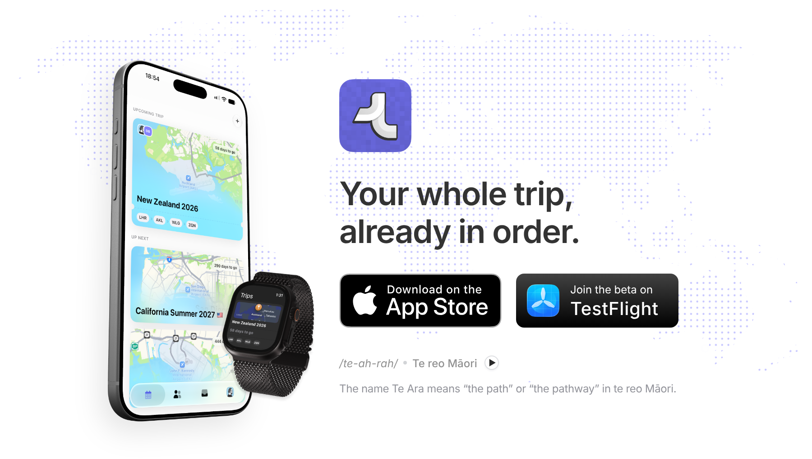

# teara.io

The landing page for **Teara**, an iPhone app that keeps your whole trip in one place: bookings, destinations, reservations and daily plans, organized into one day by day itinerary.

Teara is designed and built independently by [Guy Magen](https://www.guymagen.com), a Senior Product Designer and builder. It is live on the App Store and free to use.

**[Visit teara.io →](https://teara.io)** · **[Download on the App Store](https://apps.apple.com/il/app/teara/id6800005317)** · **[Join the TestFlight beta](https://testflight.apple.com/join/YMMtMJGQ)**

The name comes from *Te Ara*, which means "the path" or "the pathway" in te reo Māori.

## What the site covers

- **Features.** Forward a booking confirmation email and Teara extracts the details on your device for you to review. Add accommodation, rentals, transport, dining, activities, adventures and notes to the right day. Invite the people you're traveling with to one shared itinerary. Work through a pre-flight checklist for passports, visas and travel insurance.
- **Roadmap.** A public board of what's done, in progress and coming next, with the current App Store release shown on top.
- **FAQ, support and privacy.** Straight answers about how booking emails become part of a trip, what you can add, and what it costs.

## How it's built

**Site**

- Plain **HTML, CSS and JavaScript**, with no framework and no build step, so the page stays fast and easy to change
- **DM Sans** for type, **Material Symbols** for icons
- Light and dark themes that follow the device setting
- Feature demos as short **60 fps videos** that play in sequence as you scroll and replay on hover or tap
- An Apple Watch mockup in the hero with a "coming soon" tooltip, and a dotted world map with route lines behind the devices

**Release status**

- The roadmap badge shows the current App Store version. A small **Node** script (`scripts/sync-teara-status.mjs`) reads it from the **App Store Connect API** through a private connector, so no credentials live in this repository.

**Shipping**

- **GitHub** for source, **Netlify** for hosting. Every change goes to a `staging` branch and a Netlify deploy preview first, and reaches teara.io only after review.

**Design and AI in the workflow**

- Designed in **Figma**, with app screenshots and device mockups from the Teara app itself
- Built with **OpenAI Codex** and **Claude** as coding partners. I set the direction, design and review every change.

## The app

Teara is a native iOS app built with **SwiftUI** and **SwiftData**, with trip data kept in sync through **iCloud**. The app's source is private.

## Contact

[teara.io](https://teara.io) · [guymagen.com](https://www.guymagen.com)

Copy, screenshots, app artwork and the Teara name and icon belong to Guy Magen and are not licensed for reuse. App Store and TestFlight badges are trademarks of Apple Inc.
